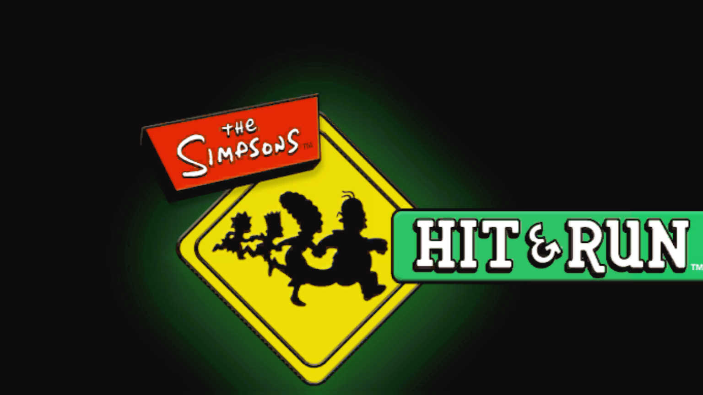
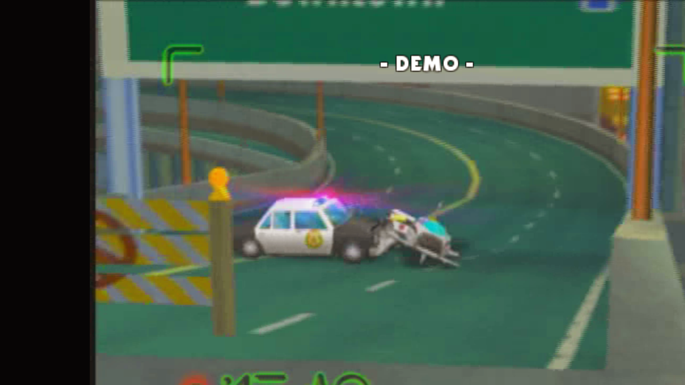

# The Simpsons: Hit & Run — Recomp

An unofficial fan-made native PC port effort for the original Xbox release of
*The Simpsons: Hit & Run* (2003), built with static recompilation.

> **Status: bring-up build.** The game currently builds and boots to the title
> screen and attract-mode demo. It is not a finished or polished release, and
> gameplay has not yet been fully verified.

## What this is

This project translates the original Xbox executable ahead of time into native
code and pairs it with a runtime that reimplements the console services the game
expects. It is not an emulator and it does not contain game assets.

The port is based on the original Xbox version and XDK build 5455. That build
was not previously covered by the upstream XboxXBERecomp SDK signature sets, so
the current work includes bootstrapping and validating a local 5455 signature
and layout set.

## Current progress

Last verified locally in November 2026:

- 134 of 248 host-replaced symbols resolved.
- 10 of 13 required data symbols resolved.
- Full XBE codegen completes: 20,674 functions translated.
- Native Windows build links successfully.
- Boot reaches the title logo and attract-mode demo.
- Enter input was verified to leave demo mode and return to the title screen.
- Several early crashes were fixed, including a DSound AddRef null-vtable path,
  incorrect 5455 VBlank structure offsets, missing D3D global data, and missing
  BinkWait/BinkNextFrame identifications.

## Not finished yet

- `DSound_StreamVtable`, `DSound_StreamVtable2`, and `D3D_FvfShader` remain
  unresolved; candidate vtable addresses have deliberately not been guessed.
- Many 5455 device-layout fields are still seeded from another XDK build and
  need binary proof.
- Menus beyond the title/demo flow, gameplay, saving, audio correctness,
  performance, graphical correctness, and stability have not been verified.
- There is no downloadable build yet.

## How it works

1. The original Xbox `default.xbe` is analyzed function by function.
2. Xbox library functions are identified so the native runtime can replace
   them with PC implementations.
3. Game code is statically translated to C++ and compiled ahead of time.
4. The runtime supplies D3D12 rendering, DirectSound/XAudio2 audio, input,
   files, threads, and other Xbox system services.
5. Per-game hooks are added only where a specific build or title needs them.

Key upstream projects and tools:

- [XboxXBERecomp](https://github.com/TGP482/XboxXBERecomp)
- [XbSymbolDatabase](https://github.com/Cxbx-Reloaded/XbSymbolDatabase)
- [extract-xiso](https://github.com/XboxDev/extract-xiso)

## Legal and game files

This is an unofficial fan project by VetTV Studios. It is not affiliated with
or endorsed by the rights holders or original developers of *The Simpsons:
Hit & Run*, The Simpsons, Microsoft, or Xbox.

You must supply your own legally acquired copy of the original Xbox game.
Do not ask for, upload, or redistribute ISOs, XBEs, extracted game files, keys,
or other copyrighted game data. This repository is intended to contain only
project-authored documentation, site files, and—after review—port code that
does not include game assets.

## Roadmap

- Pin the DirectSound stream vtables with constructor/call-site proof.
- Prove the remaining 5455 device-layout fields.
- Test title menus, controller/keyboard input, and first playable mission.
- Track crashes and graphical/audio defects with reproducible logs.
- Expand symbol coverage only where runtime behavior needs it.

## Project site

A GitHub Pages draft lives in [`docs/`](docs/). After review and publishing,
the planned site address is
`https://vettv-studios.github.io/simpsons-hit-and-run-recomp/`.

See [PUBLISHING.md](PUBLISHING.md) for the maintainer checklist used to put this
draft on GitHub.
